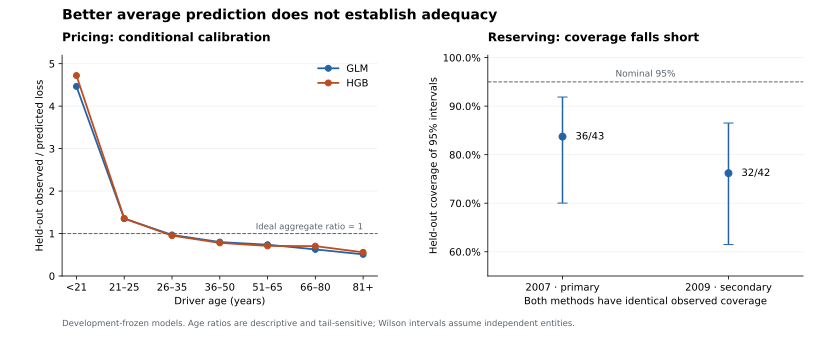

# Insurance Pricing & Reserve Uncertainty

**Prasanna K · M.A. Actuarial Economics, Madras School of Economics**

Two independent actuarial studies: French motor loss-cost modelling and U.S.
private-passenger auto net-paid reserving. The question is whether added model
complexity improves a decision when calibration, information timing and
uncertainty are checked explicitly.

| Final-test decision | Measured evidence | Practical limit |
|---|---|---|
| Select fixed boosting for the historical pricing comparison | 1.82% lower calibrated annual-loss Tweedie deviance than a Poisson/Gamma GLM across 135,198 policies; paired difference −1.449756, 95% bootstrap interval [−2.235887, −0.612689] | Conditional calibration remains poor; under-21 observed/predicted loss is 4.721. The severity component is worse. |
| Retain Mack as the reserve reference | Simulation-minus-Mack normalized 95% interval-score difference +0.001709, 95% interval [−0.002275, +0.006535], across 43 entities at 2007 | Both nominal 95% intervals cover only 36/43 outcomes (83.7%). Retaining a reference does not validate its coverage. |

These findings do not establish a deployable tariff, commercial savings,
regulatory reserve adequacy or current Indian insurer experience. The two
populations are never joined.

**Status:** final comparisons, technical report and decision memo complete.
A fresh source/output directory rebuilt all models and reproduced ten analysis
outputs byte-for-byte in the same Python environment. The [live explorer](https://prasanna-k-123.github.io/insurance-price-reserve-risk/) is public. Desktop, 375-pixel and 320-pixel
browser views, keyboard controls and report links have been checked. See [release status](docs/RELEASE.md).

## Inspect the work

- [Decision memo](reports/DECISION_MEMO.md): conclusions and application boundaries.
- [Technical report](reports/TECHNICAL_REPORT.md): methods, final evidence and failures.
- [Interactive explorer source](docs/index.html): download the repository and open
  `docs/index.html` in a browser. It works without a server or external assets.
  Pricing sliders are explicitly hypothetical; reserve controls display measured
  evidence for two dates and two nominal interval levels.
- [Frozen protocol](docs/PROTOCOL.md), [implementation notes](docs/IMPLEMENTATION_NOTES.md)
  and [data provenance](docs/DATA.md).



## Reproduce

Python 3.12; run from the repository root. See the [reproduction guide](docs/REPRODUCE.md)
for verified scope, source access and the exact checks.

```bash
python -m pip install -r requirements.txt
python scripts/audit_data.py
python scripts/reserve_valuation.py
python -m unittest discover -s tests -v
python scripts/run_baselines.py
python scripts/report_baselines.py
python scripts/run_challengers.py
python scripts/evaluate_final.py
python scripts/check_reproduction.py
python scripts/report_final.py
python scripts/build_demo.py
```

Acquisition checks pinned source hashes and stops on changes. Network access is
source-dependent; the verified reproduction reused checked raw bytes. Raw data,
fitted models and policy/entity-level predictions remain excluded from Git.
No claim of fresh-network or cross-platform reproduction is made.

## Evidence controls

The pricing audit reconciles 677,991 policies with 26,444 claims. All exposures
and losses remain uncapped. Claims stay with their policy; preprocessing uses
training data, and aggregate calibration uses development data only. Policy
dates are unavailable, so the pricing split is not temporal.

Reserve eligibility and fitting use only cells visible at the valuation.
Negative net increments are retained within the positive-cumulative domain.
The target is additional net paid loss through lag 10, not an unobserved
ultimate. Normality, entity dependence and finite simulation error are explicit
limitations. Public comparisons are dimensionless because the exact export's
currency scale has not been verified.

The protocol was committed before fitting; computational source, calibration,
fitted models and reserve forecasts were sealed before final scoring. Eighteen
focused tests cover numerical reference values, information boundaries and
artifact integrity. The saved results are implementation evidence, not an
independent external audit. See [final checks](reports/final_verification.json)
and [source reproduction](reports/reproduction_verification.json).
